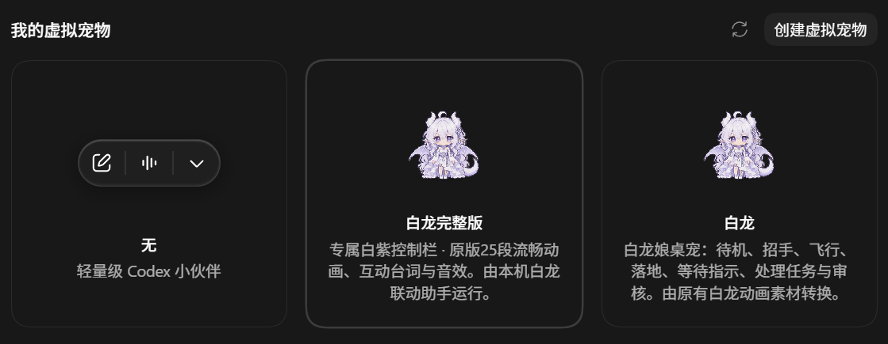

# 白龙桌宠 · Codex 适配版

让白龙陪伴你的 Codex 工作：保留原作的动画、台词与音效，加入专属控制栏、跨项目任务状态卡和聊天联动。

基于 [jingh12312-rgb / bailong-desktop-pet](https://github.com/jingh12312-rgb/bailong-desktop-pet) **v0.4.1** 制作，已获原作者同意以 fork 形式发布。本项目在 GitHub 免费分享，不用于商业用途，非 OpenAI 官方产品。

## 下载与版本选择

当前发布：**2026.10.25-r8**。支持 Windows 10/11 x64 和 Codex 桌面版。

| |   完整版 | Codex 原生简化版 |
|---|---|---|
| 动画 | 25 段、2529 帧，使用透明边缘清理后的素材 | 9 种原生状态、57 个姿态帧 |
| 台词与音效 | 保留原作内容 | 不包含 |
| 操作界面 | 白紫专属控制栏与错层任务卡 | Codex 自带的 Mini 界面 |
| 运行方式 | 原版引擎＋本地联动助手 | 由 Codex 自身播放 |
| 适合谁 | 希望保留完整白龙体验 | 希望直接使用原生 Mini |
| 下载大小 | 约 773 MB | 约 2.1 MB |
| 安装包 | [下载完整版](https://github.com/xiamoqingliang/bailong-codex-pet/releases/download/v2026.10.25-r8/Bailong-Codex-Full-Clean-2026.10.25-r8.zip) | [下载原生简化版](https://github.com/xiamoqingliang/bailong-codex-pet/releases/download/v2026.10.25-r8/Bailong-Codex-Native-Minimal-2026.10.25-r8.zip) |

两个版本均无需另装 Python，解压后提供 **一键安装到Codex.cmd** 和 **一键卸载白龙.cmd**。请下载上表中的安装包；GitHub 的 **Source code** 是源码，不是完整运行包。

## 修改内容

### 接入 Codex 宠物列表

将“白龙完整版”和“白龙”加入 Codex 的宠物列表。完整版根据宠物选择、显示／隐藏操作及 Codex 的启动与退出同步运行，也可从专属栏和托盘控制显隐。

### 白龙专属控制栏

采用与角色相配的白紫配色，集中提供 **聊天、历史、额度、动作** 入口。拖动白龙或控制栏标题时，控制栏与白龙一起移动。

### 跨项目任务卡与动画联动

同时展示本机多个项目／聊天的任务状态，用错层叠放的卡片呈现标题和状态，点击卡片即可返回对应 Codex 聊天。白龙会根据任务进展切换工作、完成等动作。

### 与桌面端同一条 Codex 聊天联动

白龙发送的消息由桌面端同一条 Codex 聊天执行，回复实时回到白龙，并保留原有的本地历史界面。需要确认权限或补充信息时，在 Codex 中操作。

### 动画素材整理与双版本安装包

完整版采用透明边缘清理后的动画，保留原画内容、完整帧数与播放时序。原生简化版提供适合 Codex 自身播放的轻量图集。

两个安装包均只保留必要运行文件，提供安装与卸载入口；完整版只保留一套处理后的动画，不重复打包原始素材。

## 保留原作的内容

完整版继续使用原作者的引擎、角色美术和基础功能：

- 25 段透明动画：2 套待机、15 个互动、5 个工作动作，以及查询、拖拽和落地。
- 原有互动台词与点击音效。
- 聊天、本地历史、Codex 额度查询和动作菜单。
- 拖动、托盘操作、全屏自动隐藏及动画预加载。

以上内容来自原作；本项目主要增加 Codex 的接入与联动体验。

## 安装使用

1. 安装 Codex 桌面版，并登录自己的账号。
2. 下载所需版本，将压缩包完整解压到本机文件夹。
3. 双击 **一键安装到Codex.cmd**，按照安装结果提示操作。
4. 新导入的条目若未出现，完成当前任务后重开 Codex；需要时点击“显示虚拟宠物”或“显示 Mini”。

完整版的解压目录用于日常运行，请保留整个目录；移动后重新运行安装入口。首次启动需要预载完整动画。简化版安装后，素材已复制到 Codex 的宠物目录，不依赖解压目录运行。

## 卸载

删除文件夹前，运行包内的 **一键卸载白龙.cmd**，等待窗口结束后再删除解压目录。

卸载会停止这份安装的后台助手、取消对应自启动，并清理匹配的本地白龙入口。聊天历史、项目文件和其他 Codex 设置会保留；已修改的素材或其他安装目录仍在使用的条目也会保留。

Codex 缓存或云端同名条目仍由 Codex 管理，如列表中仍有显示，可在宠物列表中另行删除。

## 使用说明

- 聊天和额度查询使用你自己的 Codex 账号与额度；安装包不包含账号、聊天记录或个人配置。
- 聊天联动对应 **Codex 桌面端**，不接入普通 ChatGPT 网页聊天记录。仅在 Codex 原生界面发起的新轮次，暂不自动补入白龙的本地历史。
- 任务卡以本机可识别的主聊天状态为准；等待确认状态取决于原生界面可提供的信息，不保证覆盖远程任务或全部子代理。
- 原生简化版采用现有的 9 状态图集，不包含完整版的全部动画、台词、音效与专属控制栏。

## 动画去噪工具

提供使用的 [透明边缘清理工具包](https://github.com/xiamoqingliang/bailong-codex-pet/releases/download/alpha-cleanup-tool-2026.10.25/Bailong-Alpha-Cleanup-Tool-2026.10.25.zip)（约 18 KB），源码和使用方法见 [tools/alpha-cleanup](tools/alpha-cleanup/README.md)。

工具针对白龙 v0.4.1 的 720×720 透明动画，仅清理符合规则的透明边缘像素，保留 RGB、帧数和播放时序。支持指定输入／输出目录和生成预览，不覆盖原素材。需要 Python 及依赖，包内不含角色素材。

## 致谢与许可

感谢 [jingh12312-rgb](https://github.com/jingh12312-rgb) 创作并授权发布白龙桌宠适配版。欢迎关注 [原项目](https://github.com/jingh12312-rgb/bailong-desktop-pet)。

原代码与角色素材的许可，以及他人继续修改、分发或商用的权限，由原作者决定；本项目不额外授予相关权限。第三方组件遵循各自许可，随完整版安装包保留。详见 [署名与许可说明](NOTICE.md)。
