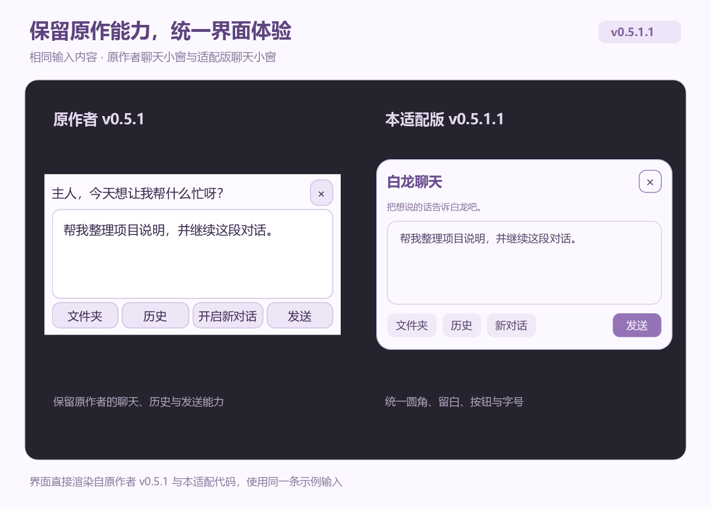
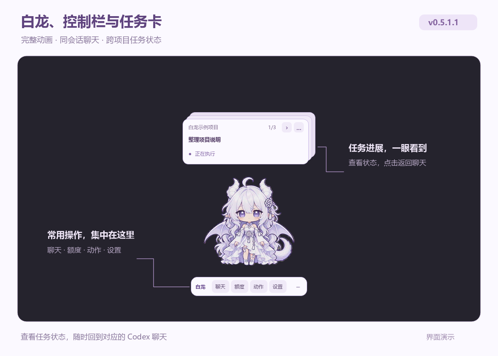
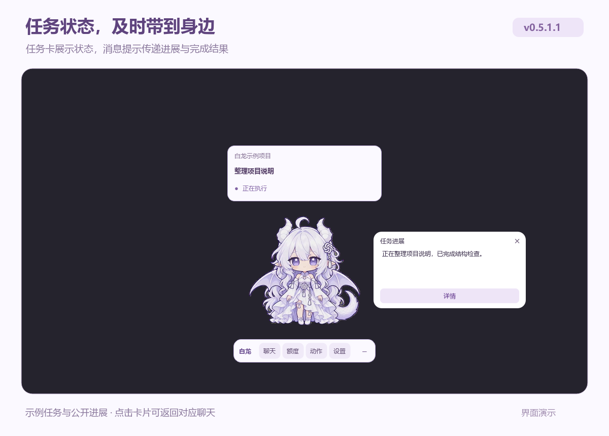
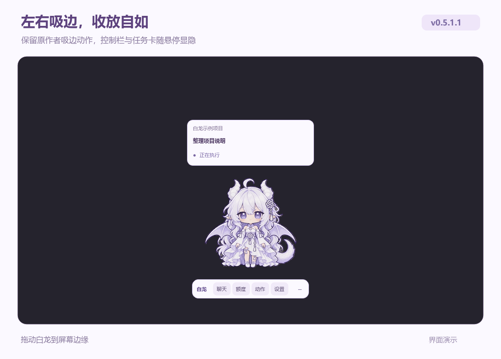
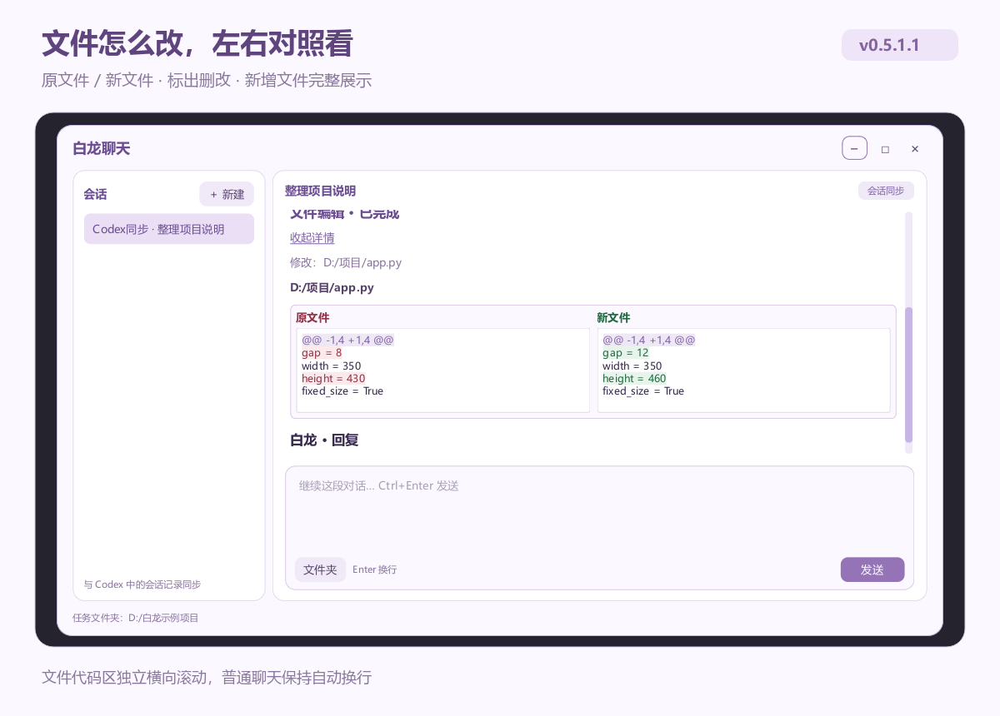
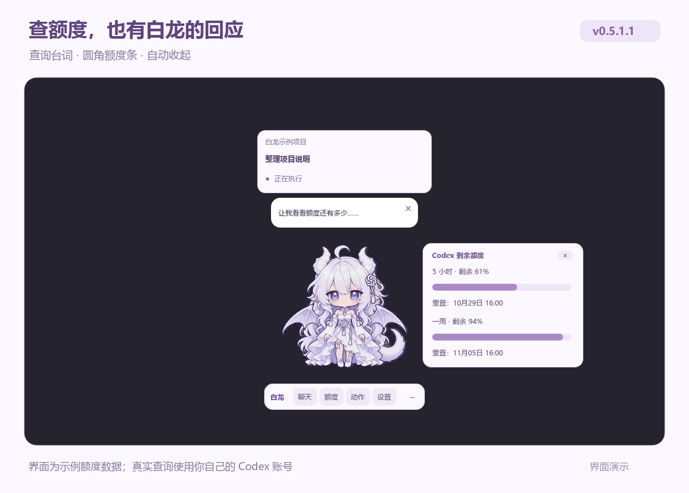
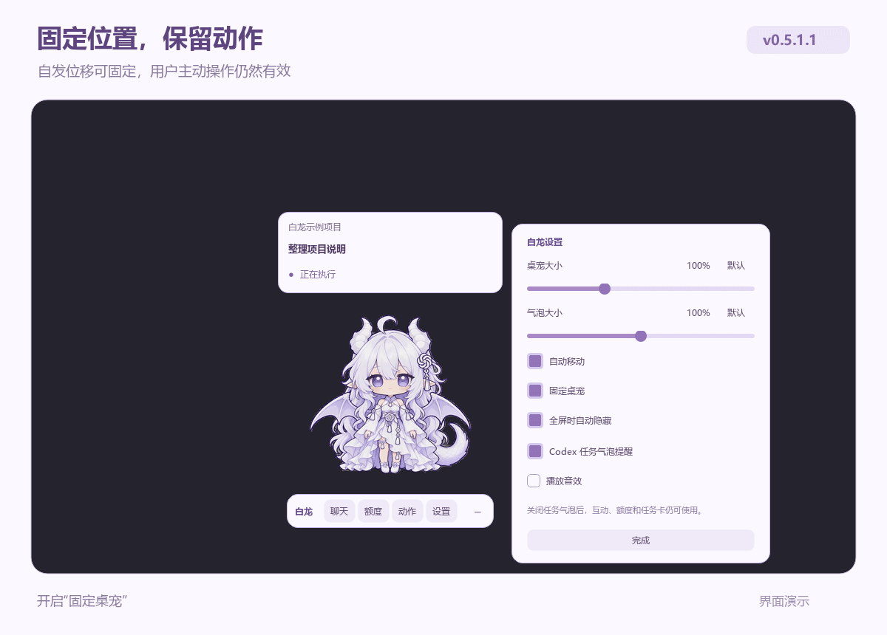
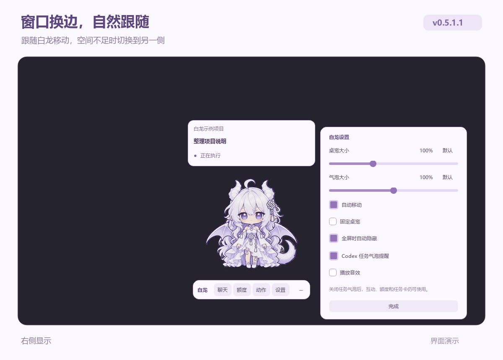

# 白龙桌宠 · Codex 适配版

让白龙陪伴你的 Codex 工作：保留原作的动画、台词与音效，加入专属控制栏、跨项目任务卡、同会话聊天和统一的白紫色界面。

基于 [jingh12312-rgb / bailong-desktop-pet](https://github.com/jingh12312-rgb/bailong-desktop-pet) **v0.5.1** 制作，适配版本为 **v0.5.1.1**。已获原作者同意以 fork 形式免费发布，不用于商业用途，非 OpenAI 官方产品。

## 下载

当前版本：**v0.5.1.1**。面向 Windows 10/11 x64 与 Codex 桌面版，完整安装包约 **298 MiB**。

| 文件 | 下载 |
| --- | --- |
| 完整安装包 | [下载 Windows x64 完整版](https://github.com/xiamoqingliang/bailong-codex-pet/releases/download/v0.5.1.1/Bailong-Codex-v051-0.5.1.1-windows-x64.zip) |
| SHA-256 校验文件 | [下载 SHA256SUMS.txt](https://github.com/xiamoqingliang/bailong-codex-pet/releases/download/v0.5.1.1/SHA256SUMS.txt) |

完整解压后提供 **一键安装到Codex.cmd** 与 **一键卸载白龙.cmd**，无需另装 Python。日常使用下载完整安装包即可；GitHub 自动生成的 Source code 是源码。

## 与原版 v0.5.1 的区别

原作者已提供完整角色动画、互动台词与音效、自移动、左右吸边、大小调节、聊天、历史、额度查询和任务进展气泡。本项目保留这些能力，围绕 Codex 桌面工作流程进行适配：

- **接入 Codex 宠物列表与显隐联动**：选择白龙后由独立助手显示完整桌宠，随 Codex 和用户操作管理启停与显隐。
- **增加专属控制栏与跨项目任务卡**：常用入口集中操作，任务状态随时可见，点击卡片返回对应聊天。
- **完善聊天与工作记录**：接入桌面端同一会话，持续同步追加内容，展示命令和文件编辑记录，并提供原文件／新文件对比。
- **统一窗口与视觉体验**：白紫圆角界面、独立设置、窗口避让与互斥，以及展开、收起和换边动效。
- **整理运行与分发**：提供去噪动画、一键安装卸载、配置备份和安装归属管理。

下面使用相同的示例输入，对比原作者 v0.5.1 与适配后的聊天小窗。

## 功能展示

### Codex 联动与专属控制栏

通过 Codex 宠物列表选择“白龙完整版”，同步显示／隐藏及启动退出状态。控制栏保留 **白龙｜聊天｜额度｜动作｜设置｜−**，拖动角色或“白龙”标题即可移动桌宠。

聊天、历史和文件夹选择集中在聊天入口中，动作菜单保留互动、工作、待机及移动动作。隐藏后可从 Codex 显示入口或白龙托盘恢复。

### 跨项目任务卡与消息提醒

同时展示本机多个项目／聊天的任务状态，使用错层叠放的卡片呈现标题和状态，点击可返回对应 Codex 聊天。任务进展和完成结果通过独立消息提示送到白龙身边，任务动作保留原作者同步逻辑。

### 完整动画与左右吸边

保留 **35 段／4426 帧透明 WebM**、互动台词及音效，可单击互动、选择动作、拖拽和调整大小。动画经过审计，31 段加强去噪，4 段保留原样，颜色与时序保持不变。

保留原作者的自移动和左右吸边探头。吸边后控制栏与任务卡收起，鼠标进入白龙范围时浮现，离开后淡出。

### 同一条 Codex 聊天与历史同步

白龙发送的消息由桌面端同一条 Codex 聊天执行，回复持续回到白龙；在原生 Codex 中追加的对话也会同步。支持选择任务文件夹、新建对话、发送、停止及 `Ctrl+Enter` 发送，需要确认或补充信息时在 Codex 中处理。

历史默认打开到最新内容，已删除或归档的会话从同步列表隐藏。公开思考摘要和工具详情默认收起，展开时保留阅读位置。

### 命令记录与文件修改对比

命令执行与文件编辑按时间展示，相邻同类操作合并为一组。命令保留简洁状态与结果，详情由用户按需展开，点击查看不会重新执行操作。

文件按 **原文件／新文件** 左右对照，标出删改，变化段完整展示；新增文件显示全部内容。只有文件代码区不自动换行并提供横向滚动，普通聊天继续自动换行。

### 额度查询与白龙台词

主动查询 Codex 相关额度，保留查询台词和查询动画。额度使用圆角进度条展示，面板在白龙左右出现，成功结果约 12 秒后收起；连接等待超时会先显示失败提示再收起。

互动与查询台词使用独立消息框，短文字居中、长文字在框内滚动。额度面板与任务消息提示互斥，聊天小窗可以分别与它们同时使用。

### 统一设置与固定桌宠

大小、自移动、固定桌宠、全屏隐藏、任务提醒及音效集中在设置中。设置面板固定完整尺寸，在白龙左右居中显示，避开控制栏与任务卡；点击“完成”或再次点击控制栏“设置”均可保存并关闭。

“固定桌宠”默认关闭。开启后，自发移动只播放动画，位置保持不变；用户拖拽或手动选择移动动作仍可改变位置，设置会保存。

### 窗口避让与动态效果

白龙本体保持前层，控制栏和任务卡在其后。互动消息框、任务提示、额度、聊天小窗和设置按各自规则定位；设置打开时收起其他受约束展开层，独立历史窗口仍可使用。

界面展开、收起和淡入淡出采用统一的 0.5 倍速过渡。空间不足需要换边时，窗口先收回白龙身后，再从新方向展开；连续拖动更新目标位置，同侧移动即时跟随。

## 安装使用

1. 安装 Codex 桌面版，并登录自己的账号。
2. 将完整安装包解压到固定、当前用户可写的文件夹。
3. 双击 **一键安装到Codex.cmd**，按安装结果提示操作。
4. 若列表尚未更新，在“设置 → Mini 与虚拟宠物”中点击“刷新”，选择“白龙完整版”并允许显示。

首次启动需要预加载动画，请保留整个解压目录与 `data` 文件夹。若已有旧助手运行，安装器会等待正常关闭 Codex 后接管，不强制中断当前任务。同一时间只运行一个完整版；移动目录后重新运行安装入口。

## 卸载

删除或移走文件夹前，运行包内 **一键卸载白龙.cmd**，等待结束后再删除解压目录。

卸载会停止本次安装的助手，清理对应自启动与匹配的本地入口，并在适用时还原相关选择。聊天历史、项目文件、其他桌宠和用户后续修改的设置会保留；已被修改或仍由其他安装使用的文件按归属规则处理。云端同名条目仍由 Codex 管理，可在宠物列表中自行删除。

## 使用说明

- 聊天和额度使用自己的 Codex 账号，安装包不包含账号、聊天记录或个人布局。
- 聊天联动对应 Codex 桌面端，不同步普通 ChatGPT 网页聊天列表。
- 状态轮询、任务卡和历史读取不额外发起模型任务；从桌宠发送聊天或任务会正常使用自己的 Codex 额度。
- 任务卡依据本机可读的聊天状态，不保证覆盖远程任务或全部子代理。Codex 接口变化后可能需要适配。
- 当前在本机 Windows 环境完成验证；其他系统和 Windows ARM 未验证。
- 本页配图由实际界面渲染，任务、聊天和额度均使用示例数据。

## 项目文档

运行代码与维护工具保留在仓库中。查看 [源码与开发说明](docs/SOURCE.md)、[项目架构与运行流程](docs/项目架构与流程-v0.5.1.1.md)。普通使用者直接使用完整安装包即可。

## 致谢与许可

感谢 [jingh12312-rgb](https://github.com/jingh12312-rgb) 创作并授权发布白龙桌宠适配版，欢迎关注 [原项目](https://github.com/jingh12312-rgb/bailong-desktop-pet)。

原代码和角色素材的许可，以及后续修改、分发与商用权限由原作者决定；本项目不额外授予相关权限。第三方组件遵循各自许可，随完整安装包保留。详见 [署名与许可说明](NOTICE.md)。
