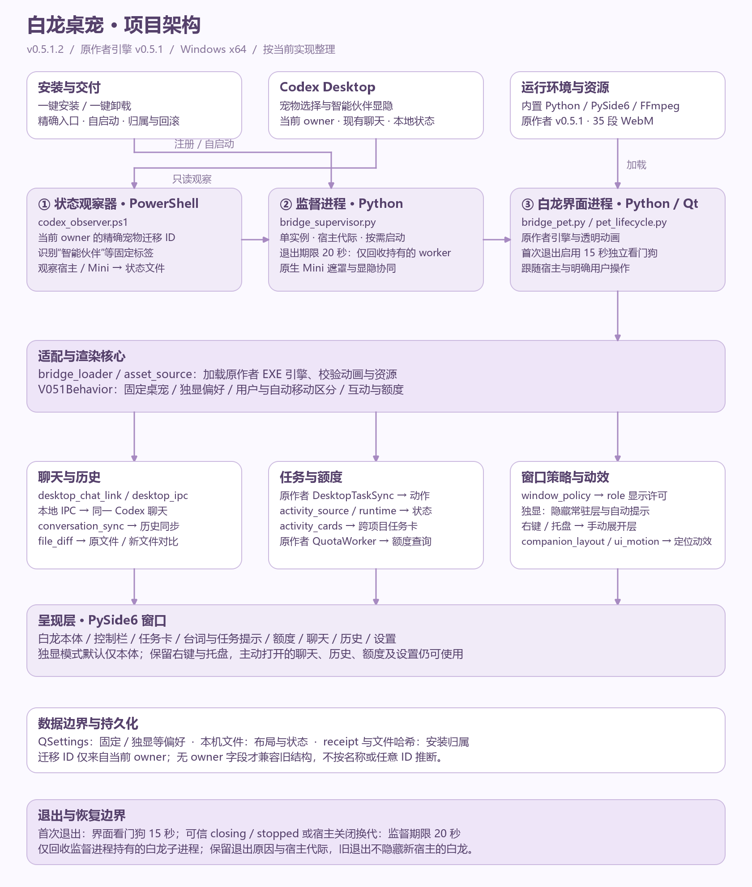
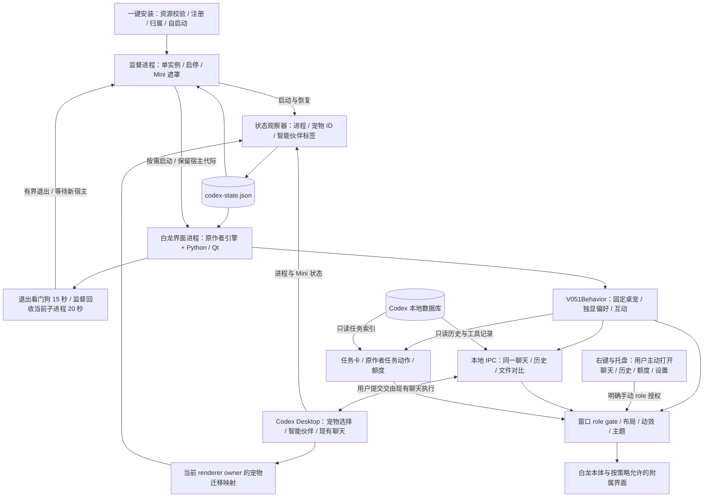
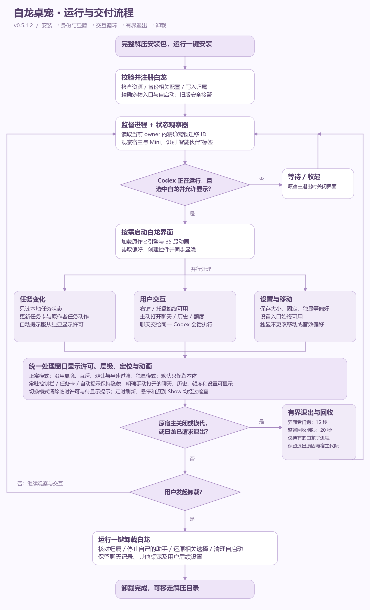
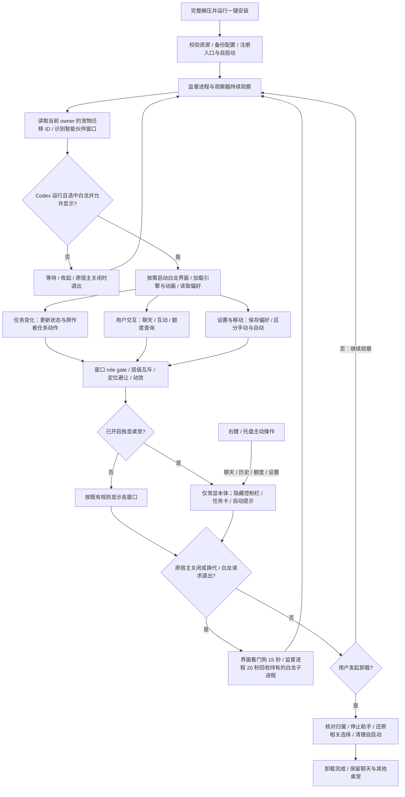

# 白龙桌宠 v0.5.1.2：项目架构与运行流程

适配版 v0.5.1.2，基于原作者 v0.5.1 引擎，运行平台为 Windows x64。
本文描述当前代码中的调用关系；流程图为主要业务流程，不表示每次循环都重新启动进程。

## 1. 总体架构

项目以独立助手接入 Codex Desktop，复用原作者的动画、互动、音效和额度查询能力。
主要运行单元是监督进程、PowerShell 状态观察器、Python / Qt 白龙界面进程；Codex Desktop 是外部宿主。





### 运行进程

| 单元 | 入口 | 主要职责 |
|---|---|---|
| 监督进程 | `bridge_supervisor.py` | 单实例、启动状态观察器、判断是否启动白龙、有限故障恢复、20 秒有界回收、原生 Mini 显隐与遮罩协同。 |
| 状态观察器 | `codex_observer.ps1` | 观察 Codex 进程、当前 owner 的宠物选择和迁移 ID、Mini 与“智能伙伴”标签，写入 `codex-state.json`。 |
| 白龙界面进程 | `bridge_pet.py` | 读取观察状态、加载原作者引擎、创建白龙与附属窗口、接入聊天和任务同步；退出时启用 15 秒看门狗。 |

观察器写出的状态文件由监督进程和界面进程分别读取；监督进程管理助手生命周期，用户原有 Codex 进程保持独立。

### 宠物身份与宿主代际

`config.toml` 的 `desktop.selected-avatar-id` 与原生显隐状态共同决定是否选中完整版。云端宠物 ID 只接受已配置白龙本地入口的精确迁移映射，不按名称或任意 `pet_` 前缀推断。

较新 Codex 将迁移表保存在 `.codex-global-state.json` 的 `electron-owner-atoms:<owner>` 对象中。观察器、安装器及原生显隐助手使用 `electron-renderer-content-owner` 指定的当前 owner；该字段存在但无效、对应容器缺失或格式错误时，不回退到历史 owner 或旧账户。只有没有 owner 字段的旧结构才读取 `electron-persisted-atom-state`，兼容既有安装。

Mini 窗口身份结合已验证的 Codex 进程、原生窗口特征和可访问性控件判断。宠物图像标签使用当前本地化模板：简体中文为“{petName} 智能伙伴”，繁体中文为“{petName} 寵物”，英文默认为“{petName} pet”。仅观察这些固定控件标签，不读取聊天正文。监督进程同时记录宿主 PID、启动时间及显示代际，区分新宿主与旧界面的迟到退出。


### 主要模块

| 模块 | 核心文件 | 职责 |
|---|---|---|
| 原作者引擎加载 | `bridge_loader.py` | 从原作者 EXE 读取 Python 模块，复用原有动画引擎。 |
| 动画资源 | `asset_source.py`、`tools/ffmpeg.exe` | 校验并加载 35 段透明 WebM；发布包使用已去噪资源。 |
| 行为适配 | `v051_behavior.py` | 固定桌宠、独显偏好、用户与自动移动区分、互动、任务消息、额度查询与设置入口。 |
| 有界退出 | `pet_lifecycle.py`、`bridge_pet.py`、`bridge_supervisor.py` | 首次退出启用独立 15 秒看门狗；监督进程按单调时钟设置 20 秒退出期限，仅回收自己持有的白龙子进程。 |
| 聊天执行 | `desktop_chat_link.py`、`desktop_ipc.py`、`desktop_chat_adapter.py` | 通过本地 IPC 将用户提交交给同一 Codex 聊天，并接收流式结果。新聊天先创建持久元数据，再交给桌面端执行。 |
| 历史与文件对比 | `conversation_sync.py`、`chat_ui_style.py`、`file_diff.py` | 同步用户与助手消息、公开摘要、命令和文件编辑记录；原文件／新文件对比与局部滚动。 |
| 任务状态与任务卡 | `activity_source.py`、`activity_runtime.py`、`activity_cards.py` | 只读本地任务索引和状态，更新任务卡，点击后返回对应 Codex 聊天。 |
| 任务动作与额度 | 原作者 `DesktopTaskSync`、`QuotaWorker` + 适配层 | 原作者同步驱动任务动作；额度查询复用原作者能力，并由适配层处理展示和有效期。任务卡元数据驱动与动画驱动分开。 |
| 窗口管理 | `window_policy.py`、`companion_layout.py` | 控制 role 显示许可、层级、互斥、延迟显示、到期丢弃、侧边与上下定位和避让。 |
| 视觉与动效 | `ui_motion.py`、`bailong_theme.py` | 白紫圆角样式、统一半速过渡、跟随、收回与换边。 |
| 安装与卸载 | `packaging/compact_install.py`、`uninstall_pet.ps1` | 注册本地宠物及备用入口、记录归属、备份和还原相关配置、清理自己的进程与自启动。 |

## 2. 主要运行流程





任务同步、用户交互与设置更新是并行事件来源，不需要三者全部完成后才刷新界面。
监督进程根据状态决定继续运行、收起或结束界面进程；手动退出与隐藏按各自生命周期策略处理。

界面进程首次进入退出流程时启动独立的 15 秒退出看门狗，防止聊天或额度线程的关闭重试无限等待。监督进程另以单调时钟记录退出期限：确认界面进程正在退出，或其原宿主已经关闭／换代后，20 秒内仍未结束则仅回收自己持有的白龙界面子进程。旧宿主退出、当前用户手动退出及新宿主启动分别处理，旧进程的退出结果不能隐藏或抑制新宿主的白龙。普通隐藏和暂时读不到观察状态不会触发这项回收。

Codex 保存的智能伙伴显隐开关继续作为显示依据；开关关闭时需由用户手动开启。

### 独显界面的显示许可

`petOnly` 保存于当前版本的 QSettings，运行时由 `pet.pet_only` 与 `window_policy().set_pet_only()` 协调。开启时清除待显示通知、手动 role 授权和展开层，取消既有窗口动画；控制栏、任务卡、互动台词和自动任务提示保持隐藏。它只改变本机附属界面的呈现，不改写 Codex 的显隐开关，不更改固定桌宠、自移动或音效偏好。

右键与托盘菜单保留，设置入口始终允许。用户明确打开聊天或历史时，策略为 composer / history role 授权；明确查询额度时为 quota role 授权。自动任务提示不获得授权，不排队回放。`ui_motion.show()` 与窗口 Show 事件均检查许可，控制栏、任务卡和吸边悬停另有直接检查，防止轮询或迟到的显示回调绕过模式。切换模式会清除临时授权；关闭模式后只按当前显隐、全屏及吸边规则恢复常驻控制栏和任务卡。


## 3. 关键规则

- **窗口层级**：白龙本体在最前，控制栏和任务卡其次，其他展开层在其后；历史窗口独立，允许显示在本体之上。
- **设置互斥**：设置打开时关闭任务提示、额度面板和聊天小窗；互动消息框与历史独立。用户打开其他窗口时先保存关闭设置，系统提示等待且沿用原有效期。
- **消息类型**：互动和额度台词属于独立消息框；任务进展和任务完成属于任务消息提示。任务消息提示与额度面板互斥，聊天小窗可与二者分别并存。
- **固定桌宠**：默认关闭；开启后，自发移动动画原地播放。用户拖拽与手动移动仍可改变位置。
- **独显桌宠**：默认关闭，开关状态会保存。开启时隐藏常驻控制栏、任务卡和自动提示；保留右键与托盘菜单，用户主动打开的聊天、历史、额度及设置仍可使用。关闭后恢复常驻控制栏和任务卡，并继续服从隐藏、全屏及吸边规则。
- **固定设置尺寸**：350×460 逻辑像素，保持左右居中，并横向避开任务卡和控制栏。
- **动效**：展开 640ms、收起 440ms、同侧让位 400ms；换边为 320ms 收回 + 80ms 停顿 + 400ms 展开。连续拖动更新目标而不重置时间线；同侧跟随即时完成。
- **额度有效期**：结果显示 12 秒；查询等待上限 30 秒，失败时先显示连接失败提示再按规则收起。等待设置关闭时不延长提示寿命。
- **数据读取与执行**：任务与历史同步只读本地状态；不会因读取历史而执行命令。仅用户明确发送聊天后才交由 Codex 执行；连接结果不明确时不自动重发。

## 4. 目录与交付

```text
v051/
├─ codex-integration/
│  ├─ bridge/                 # 运行入口、适配行为、窗口与聊天模块
│  ├─ full-entry/             # Codex 宠物入口与预览素材
│  ├─ clean-assets/           # 开发目录中的去噪动画
│  └─ edge-repair/            # 动画审计与去噪工具
├─ packaging/                # 安装、卸载、打包与隔离验证
├─ runtime/                  # 内置 Python
├─ _internal/                # 原作者运行依赖
├─ tools/                    # FFmpeg
├─ docs/                     # 项目说明、架构与流程图
└─ releases/0.5.1.2/         # 已校验的安装包、源码包与哈希
```

完整安装包顶层为“一键安装到Codex.cmd”“一键卸载白龙.cmd”“README.md”和 `data/`。
发布包将选定动画放在 `data/outputs/白龙桌宠素材`，不携带本机配置、日志和聊天历史。
项目源码包保留维护代码，开发时与完整安装包内的运行环境及资源配合使用。

PNG 便于直接查看，SVG 可继续编辑，本文的 Mermaid 代码可用于维护结构关系。
